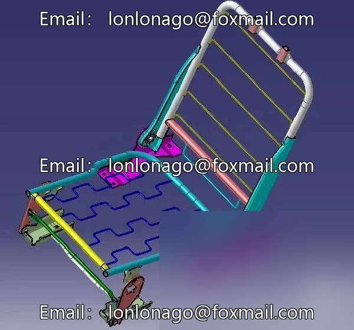

# Seat frame 3D custom design

## Body

Seat skeleton 3D custom design, seat skeleton design, seat skeleton drawing, seat skeleton model, seat skeleton 3D, seat skeleton data model.
Additionally, it can be customized and designed according to your needs.
Multiple models can be opened and edited with CATIA UG, SolidWorks, etc.
A009 also includes other various types of 3D drawings, modeling, and model/number model modification services, and can be discussed in detail specifically.

The image is empty; based on the title and body, service for seat skeleton 3D custom design, design modeling, and model modification is provided.

<!-- AI_ENRICHED -->

## Images

## Payment

Here is a pay link on Stripe ( https://buy.stripe.com/3cs8yP7sY87d0vu9AB ). Please contact me lonlonago@foxmail.com after funding $89, and I will send you a complete data files , thank you!

